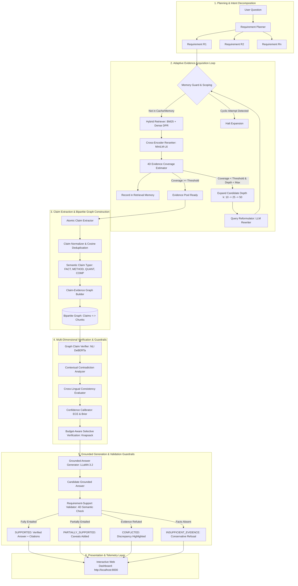

# AERIS System Architecture

This document details the architectural design, algorithmic workflows, data schemas, and mathematical formulations of the **AERIS-RAG (Adaptive Evidence Retrieval and Information System)** pipeline.

---

## 1. High-Level System Architecture Diagram



---

## 2. Pipeline Execution Stages & Mathematical Foundations

The AERIS pipeline executes 13 strictly sequenced stages inside `AERISController.run()`:

### Stage 1: Information Requirement Planning
Complex user questions are decomposed into atomic, testable requirements $R = \{r_1, r_2, \dots, r_m\}$. Each requirement $r_i$ defines:
- **`description`**: The specific factual objective (e.g., *"Identify the first author of the paper"*).
- **`requirement_type`**: `factual`, `comparative`, `methodological`, or `quantitative`.
- **`priority`**: Priority weight ($1 = \text{essential}, 2 = \text{supporting}$).
- **`retrieval_queries`**: Targeted sub-queries designed to retrieve focused text passages.

### Stage 2: Memory Guard & Session Scoping
To prevent infinite retrieval loops and duplicate API calls, AERIS maintains a scoped retrieval memory $M$:
$$M = \{(q_{\text{sub}}, r_{\text{id}}, k_{\text{depth}})\} \subset \mathcal{Q} \times \mathcal{R} \times \mathbb{N}$$
If a query-requirement-depth tuple has already been attempted in the active session, redundant retrieval is bypassed.

### Stage 3: Hybrid Retrieval & Reciprocal Rank Fusion (RRF)
Retrieval combines dense semantic search and sparse lexical keyword search:
- **Dense Retriever:** Uses `nomic-embed-text` embeddings with Maximum Inner Product Search (MIPS) via FAISS.
- **Sparse Retriever:** Uses BM25 with standard Okapi parameters ($k_1=1.5, b=0.75$).
- **Fusion:** Candidate passages are merged using Reciprocal Rank Fusion:
  $$RRF(d) = \sum_{m \in \{\text{dense}, \text{sparse}\}} \frac{1}{60 + \text{rank}_m(d)}$$

### Stage 4: Cross-Encoder Reranking
Top candidates from RRF are scored by a cross-encoder model (`cross-encoder/ms-marco-MiniLM-L-6-v2`):
$$s_{\text{rerank}}(q, d) = \sigma(W \cdot \text{BERT}(q, d))$$
This captures fine-grained token-level cross-attention between the query and candidate chunk text.

### Stage 5: 4-Dimensional Evidence Coverage Estimation
Before extracting claims, AERIS evaluates whether the retrieved pool sufficiently covers requirement $r$:
$$\text{Coverage}(r, D) = w_1 \cdot \text{Dir}(r, D) + w_2 \cdot \text{Rel}(r, D) + w_3 \cdot \text{Comp}(r, D) + w_4 \cdot \text{Type}(r, D)$$
- **Directness ($\text{Dir}$):** Degree to which evidence directly addresses the specific entity.
- **Relevance ($\text{Rel}$):** Semantic alignment score between requirement tokens and evidence.
- **Completeness ($\text{Comp}$):** Proportion of required facets present in the text.
- **Type Match ($\text{Type}$):** Match between required data type (e.g., number, name) and extracted entities.

If $\text{Coverage} < \tau_{\text{cov}}$ (threshold 0.70), the controller triggers adaptive candidate pool expansion ($k \in \{10, 25, 50\}$) and LLM query reformulation.

### Stage 6: Atomic Claim Extraction & Deduplication
Retrieved chunks are parsed into atomic, self-contained factual claims $C = \{c_1, c_2, \dots, c_p\}$:
- Each claim expresses exactly one verifiable fact.
- Semantic duplicates are detected via cosine similarity of dense embeddings:
  $$\text{sim}(c_i, c_j) = \frac{e(c_i) \cdot e(c_j)}{\|e(c_i)\| \|e(c_j)\|} > 0.88$$
  Duplicates are merged into a canonical claim node with multiple provenance edges.

### Stage 7: Semantic Claim Typing
Claims are typed to route them to specialized verification rules:
- **`FACT`**: Direct assertions of entities, authors, definitions, or classifications.
- **`METHOD`**: Procedural descriptions, pipelines, or algorithm architectures.
- **`QUANTITATIVE`**: Numerical measurements, percentages, metrics, or statistics.
- **`COMPARATIVE`**: Relative comparisons between models or configurations (e.g., *"Model A outperformed Model B"*).

### Stage 8: Bipartite Claim-Evidence Graph Construction
A formal bipartite directed graph $G = (V_C, V_E, E_{CE})$ is assembled:
- $V_C$: Extracted and typed claim nodes.
- $V_E$: Source document chunk nodes (with document ID, chunk ID, page numbers, text).
- $E_{CE}$: Directed edges $(c_i, e_j)$ representing attribution and grounding provenance.

### Stage 9: Graph Claim Verification (NLI)
For each claim node $c \in V_C$, Natural Language Inference is performed against its attached evidence chunks:
$$\text{NLI}(c, e) \in \{\text{SUPPORTS}, \text{REFUTES}, \text{NOT\_ENOUGH\_INFO}\}$$
A claim is labeled `SUPPORTED` only if its premises strictly entail the claim without external world assumptions.

### Stage 10: Contextual Contradiction Detection
Pairs of claims supported by different evidence chunks are evaluated for contradictions:
$$\text{Contra}(e_a, e_b) \in \{\text{CONTRADICTION}, \text{CONTEXTUAL\_DIFFERENCE}, \text{NO\_CONTRADICTION}\}$$
Genuine contradictions are tracked in the graph and explicitly presented to the generator to prevent silent, arbitrary choices between conflicting sources.

### Stage 11: Cross-Lingual Consistency Evaluation
For multi-lingual or translated document corpora, claim-evidence pairs are verified across language boundaries using cross-lingual alignment classifiers, preventing translation drift from introducing false factual claims.

### Stage 12: Confidence Calibration & Budget-Aware Selective Verification
To optimize compute efficiency under strict LLM latency or cost constraints, claims are selected for in-depth verification using a 0-1 Knapsack formulation:
$$\max \sum_{i=1}^n u_i \cdot x_i \quad \text{subject to} \quad \sum_{i=1}^n \text{cost}_i \cdot x_i \le B$$
Where:
- $u_i = (1 - \text{conf}_i) \cdot \text{priority}(c_i)$ represents the information utility of verifying claim $i$.
- $\text{cost}_i$ is the estimated verification inference cost.
- $B$ is the user-configured verification budget (e.g., $B = 3$).

### Stage 13: Grounded Answer Generation & Requirement Support Guardrails
The generator receives the verified claim graph and retrieved chunks:
- Prompt rules strictly prohibit outside world knowledge or ungrounded inferences.
- Output JSON requires explicit citation lists (`supporting_chunk_ids`, `supporting_claim_ids`).
- **Requirement-Support Validator (Firewall):** Post-generation guardrail that validates the generated answer against the planned information requirements:
  - If cited evidence lacks key quantitative/factual terms $\to$ **`INSUFFICIENT_EVIDENCE`** (Conservative Refusal).
  - If cited evidence directly contradicts the answer $\to$ **`CONFLICTED`**.
  - If all requirements are verified $\to$ **`SUPPORTED`** (Full Grounding).

---

## 3. Data Structures & Schemas

### Core Schemas (`app/controller/schemas.py`)

```python
class ControllerRequest(BaseModel):
    document_id: str
    question: str
    config: ControllerConfig

class ControllerResult(BaseModel):
    question: str
    document_id: str
    plan: Optional[RequirementPlan]
    retrieved_chunk_ids: List[str]
    extracted_claims: List[ClaimItem]
    verified_claims: List[VerifiedClaimItem]
    final_answer: str
    answer_status: AnswerStatus  # SUPPORTED, PARTIALLY_SUPPORTED, INSUFFICIENT_EVIDENCE, CONFLICTED
    answer_confidence: float
    supporting_chunk_ids: List[str]
    supporting_claim_ids: List[str]
    provenance: List[Dict[str, Any]]
    total_execution_seconds: float
    stages: List[PipelineStage]
```

### Claim-Evidence Graph Schema (`app/claim_graph/graph.py`)

```python
class ClaimNode(BaseModel):
    claim_id: str
    text: str
    claim_type: ClaimType
    source_chunk_id: Optional[str]
    status: ClaimStatus
    confidence: float

class EvidenceNode(BaseModel):
    chunk_id: str
    document_id: str
    text: str
    pages: List[int]

class ClaimEvidenceEdge(BaseModel):
    claim_id: str
    chunk_id: str
    relation_type: str = "supports"
```

---

## 4. Provenance & Anti-Hallucination Integrity

AERIS enforces strict provenance guarantees:
1. **Zero High-Confidence Ungrounded Answers:** Answers with confidence $> 0.5$ must cite at least one verified chunk in `supporting_chunk_ids`.
2. **Provenance Traceability:** Every cited chunk maps to exact page numbers in the indexed PDF.
3. **Conservative Refusal Rationale:** When a query cannot be answered, AERIS details the exact missing concepts (e.g., *"Patient age and demographic distributions are not present in the cited document."*) instead of outputting generic errors.
